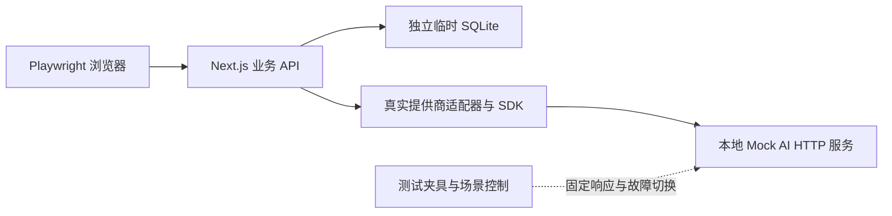

# 无真实 API Key 的 E2E 测试用例设计

- 状态：首批实现和验收已完成；8 个新增业务场景展开为 11 个执行实例，与既有用例合计 24 条。
- 设计日期：2026-11-01。
- 设计基线：`34b62c9cb3b99c1e40f2486d999c35780e1984e2`；实现验收基于 `6d04eaa` 及本次工作区更改。
- 范围：浏览器、业务 API、提供商适配器和 SQLite 真实执行；外部模型服务使用本地固定响应。

## 1. 测试边界

验证表单提交、模型请求与解析、异步状态、数据保存、刷新恢复及打印之间的配合。
真实模型的识图效果、答案质量及厂商线上可用性另行评估。



- `/api/analyze`、`/api/error-items`、`/api/practice/*`、`/api/exams/*`、导入导出等业务接口均真实执行。
- 在外部模型 HTTP 边界模拟响应，保留真实 `OpenAIProvider` 的请求构造、SDK、错误转换和结果校验。
- 核心链路不使用 `page.route(...).fulfill(...)` 替代业务 API。现有上传校对用例迁移到相同的模型模拟设施。
- 允许在准备阶段通过 Prisma 或真实 API 创建夹具；用例关注的操作通过浏览器完成。只读 API/数据库查询用于补充断言。

## 2. 运行与隔离设计

每次测试运行依次完成：

1. 创建系统临时目录，分配数据库、配置、下载和报告目录。
2. 生成 Prisma Client，使用 `prisma migrate deploy` 创建全新测试库。
3. 创建专用管理员、各用例独立的普通用户和必要的最小知识点树，标记测试安装向导已完成。
4. 在回环地址的动态端口启动 Mock AI 服务，确认服务就绪。
5. 写入仅含测试配置的独立 `CONFIG_DIR`，启动测试应用，再运行 Playwright。
6. 等待场景后台任务结束，清理夹具、终止自建进程并释放临时目录；失败时保留脱敏报告。

配置示意，由测试启动器生成并传递，不需要创建真实厂商密钥：

```dotenv
AI_PROVIDER=openai
OPENAI_API_KEY=e2e-dummy-key
OPENAI_BASE_URL=http://127.0.0.1:<动态端口>/cases/<场景ID>/v1
OPENAI_MODEL=e2e-mock-model
```

运行约束：

- 测试应用使用独立运行目录和配置，不读取本机 `.env`、真实 AI 配置或家庭数据。
- 应用与 Mock 服务地址只允许回环地址；不复用已运行的开发或家庭服务器。
- 读取运行清单后，校验服务地址并仅用数字端口重建固定 `127.0.0.1` 地址，拒绝远端主机、凭据、路径及查询参数。
- 测试运行阶段限制服务端和浏览器对外连接，出现未声明的外部模型请求即失败；不能只在浏览器侧拦截请求。
- 未声明的 Mock 请求直接报错，不回退到真实提供商。日志不记录认证头或图片原始数据。
- 单个应用实例第一阶段使用一个 worker；不同 CI 作业仍可并行。未来扩并发时，每个 worker 必须独立拥有应用、数据库、配置和 Mock 服务。
- 固定业务时区为 `Asia/Shanghai`，普通场景使用不限额的测试配置；题目、账号和目录标识包含运行 ID、用例 ID 及重试编号。
- 用例切换前等待本场景模型请求、试卷生成、掌握评估等任务收敛，避免后台请求进入下一场景。
- 浏览器退出后先终止本次应用，再定向清理两个预置管理员的空默认错题本并审计，避免已取消的页面请求重新创建默认数据。
- 现有测试对 AI 设置、导入偏好的修改也需在夹具中恢复，统一唯一测试数据及 `finally` 清理。

SQLite 仍是真实数据库。CI 可将测试临时文件放到有容量限制的内存盘，减少同步写入等待；旧库升级兼容继续由已有迁移测试验证。

## 3. Mock AI 协议与场景

### 3.1 HTTP 协议

Mock 服务提供 OpenAI 兼容的 `POST /cases/<场景ID>/v1/chat/completions`；需要模型列表时提供同前缀下的 `GET /models`。
认证仅接受固定假 Key。响应保留标准 `choices[].message.content`、`finish_reason` 等结构，题目识别和变式内容按当前适配器要求返回 XML 标签；判题及掌握评估返回 JSON，均放在 `content` 字符串中。

响应内容使用当前项目契约：

| 操作 | 固定响应内容 | 设计要求 |
| --- | --- | --- |
| 图片识别 | XML 标签映射到 `questionText`、`answerText`、`analysis`、`subject`、`knowledgePoints`、`difficultyStars`，按场景附带 SVG | 标签属于测试错题本的有效知识点范围；题目带场景唯一标记 |
| 举一反三/出卷 | XML 标签映射到 `ParsedQuestionSchema`，题目带原题标记和变式标记 | 不依赖模型随机生成；可追溯来源题目 |
| 答案判定 | `correct: true/false`、`reason` | 必须使用当前字段 `correct`，不能写成 `isCorrect` |
| 掌握评估 | `probability: 70`、`reason` | 模型结果为百分数，数据库应保存归一化后的 `0.7` |

场景按 URL、请求结构和测试题目标记分流，不匹配整段提示词文本。固定年级模式用于第一阶段，避免引入非目标的年级识别请求。
后台掌握评估必须有独立响应规则，不能消耗变式题或判题的响应队列。

### 3.2 场景控制

| 场景 | 行为 | 用途 |
| --- | --- | --- |
| `analysis-ok` | 返回固定识别结果 | 免校对导入、现有人工校对用例 |
| `variant-ok` | 按原题标记返回固定变式，按需附 SVG | 出卷、练习 |
| `grade-correct` | 返回正确及固定判定理由 | 正常练习 |
| `grade-error` | 返回不可重试的上游 HTTP 400 错误 | 判题失败后的手工判定 |
| `exam-partial` | 原题 A 成功、原题 B 持续失败；显式切换阶段后 B 成功 | 部分失败及重试 |
| `mastery-ok` | 返回固定掌握概率与理由 | 保存练习、试卷结果或重复导入后的后台评估 |
| `hold-and-release` | 收到请求后挂起，由测试夹具显式释放 | 稳定观察生成中、按钮禁用和进度状态 |

控制端点只属于本地 Mock 服务，不添加到生产业务 API 中。
Mock 记录场景 ID、操作类型、原题标记、请求序号、开始/结束状态和响应种类。

### 3.3 重试和异步规则

- 第一阶段用不可重试的上游错误构造确定失败，减少 SDK 自动重试对用例的影响。
- 后续覆盖上游 429/500 时，失败规则需持续到显式切换阶段，不能只失败第一次请求。
- 按业务操作区分请求统计，后台掌握评估与目标生成请求分开核对。
- 通过 Mock 收到请求、DOM 状态、真实接口响应和任务终态同步，不使用固定秒数等待。
- 不断言随机抽题的固定顺序；用候选集合、数量、归属及唯一性断言。

## 4. 第一批用例总览

| ID | 优先级 | 场景 | 桌面 | 手机 |
| --- | --- | --- | --- | --- |
| E2E-M01 | P0 | 免校对图片导入，真实识别接口及入库 | 是 | 是 |
| E2E-M02 | P0 | 卷别分组管理、直接录入、筛选和元数据保存 | 是 | — |
| E2E-M03 | P0 | 按卷别出卷、结果录入及配图打印 | 是 | 是 |
| E2E-M04 | P0 | 试卷部分生成失败后重试 | 是 | — |
| E2E-M05 | P0 | 举一反三判题、确认保存和刷新恢复 | 是 | 是 |
| E2E-M06 | P0 | 模型判题失败后手工确认结果 | 是 | — |
| E2E-M07 | P0 | 拒绝跨邮箱导入、同邮箱空账号恢复 | 是 | — |
| E2E-M08 | P1 | 判重阈值持久化、重复提示和比较 | 是 | — |

设计为 8 个业务场景、11 个执行实例。保留当前 13 条既有用例并升级其模型模拟方式时，完整集合为 24 条，已按该矩阵执行。
桌面使用 1280×900，手机使用 390×844 并启用触屏及移动上下文；第一阶段均使用 Chromium。

## 5. 详细用例

### E2E-M01：免校对图片导入

**前置**：独立用户、固定年级、有效错题本与标签；关闭导入前人工确认；Mock 使用 `analysis-ok`。

**操作**：从页面上传固定图片，完成裁剪，等待识别并自动保存，进入错题本后打开题目，再刷新。

**断言**：

- 识别进行中有明确反馈，目标按钮处于正确状态；页面不进入人工校对页。
- Mock 确实收到包含图片内容的模型请求，真实 `/api/analyze` 和入库接口均完成。
- 只创建一条错题，题干、答案、知识点、错题本和年级正确，刷新后仍存在。
- 本次操作未创建练习记录；没有额外重复保存。
- 现有人工校对用例也切换为 Mock 上游，继续验证修改识别结果后再保存的分支。

### E2E-M02：卷别分组与直接录入

**前置**：独立用户、已存在的 A/B 默认分组；题目内容带唯一标记。

**操作**：在设置中新建分组，返回直接录入页面选择该组并保存；按组筛选；改名后验证显示；停用后修改历史题目的年级，再刷新。

**断言**：

- 设置、录入下拉、筛选按钮及题目详情能同步反映新增和改名，不能依赖整页重开来掩盖缓存问题。
- 真实请求提交分组 ID，入库归属正确，筛选不会混入其他分组的题。
- 停用分组不再供新题选择，历史题目仍保留分组及名称。
- 修改历史题目的年级可成功，不会因未改变的停用分组而失败。

### E2E-M03：出卷、配图、结果与打印

**前置**：同一用户有两个卷别；目标卷别内准备两道题，另一卷别有一条干扰题；两道目标变式均返回有效 SVG，原题配图设置为 100%、居中。

**操作**：在页面选择错题本和目标卷别创建试卷；观察生成状态并等待完成；统一设置试卷配图为 75%、居中，再将单题改为 50%、居右；刷新、打开打印页；录入一次两道题的作答结果并保存。

**断言**：

- 候选来源、实际题数和来源短 ID 正确，排除其他卷别；生成反馈能从进行中到完成。
- Mock 返回的固定变式、答案和 SVG 正确呈现。
- 单题与统一配图设置独立生效，刷新及 print 媒体下的比例、位置一致；原题配图设置保持原值。
- 每道选中题新增一条对应的试卷来源练习记录，原题历史和试卷结果都可查看。
- 刷新或重新查看不新增作答记录；用户主动再次录入是一轮新作答，不在本用例中当作重复提交禁止。

按创建、配图、打印、结果四个检查点组织步骤和失败截图，便于定位。

### E2E-M04：试卷部分失败与重试

**前置**：两道来源题，Mock 对 A 成功、对 B 返回固定错误。

**操作**：创建试卷，等待部分失败终态；核对错误和重试入口；将 Mock 的 B 切换为成功，点击页面重试，等待完成并刷新。

**断言**：

- 成功题可以查看，失败题显示反馈，页面不永久停在生成中。
- 重试保持同一试卷 ID，不新增试卷或重复题目。
- 已成功题的 ID、内容和配图保留；重试只对未成功题再次请求模型。
- 重试成功后状态和内容正确，刷新后保持。

### E2E-M05：练习判题与确认保存

**前置**：一条原题，Mock 返回需要说明理由的变式，判题返回 `correct: true`。

**操作**：从原题进入举一反三，选择难度并生成；输入答案提交；阅读判定理由，明确点击保存结果；进入原题历史，再重新进入练习页。

**断言**：

- Mock 确实收到变式生成和答案判定请求，避免答案本地匹配短路导致没有测试到模型判题。
- 页面显示固定题目、判定结果和理由。
- 判题完成时尚未写入练习记录；用户确认保存后才新增一条，关联原题及生成内容快照正确。
- 保存完成后按钮状态正确，历史可见；后台掌握评估完成并按固定响应持久化。
- 重新进入显示服务端暂存题目，不重新调用生成，也不因读取暂存而新增记录。

### E2E-M06：判题失败后的手工结果

**前置**：变式生成成功，题目需说明理由；Mock 判题持续返回上游错误。

**操作**：提交答案，等待失败提示及参考答案；手工选择做错并确认保存，再打开历史并刷新。

**断言**：

- 失败后恢复可操作状态，参考答案和手工判定入口可用，不永久加载。
- 模型不可用不会被自动解释为学生答错；手工确认前没有新增作答记录。
- 用户确认后仅新增本次做错记录，后台评估正常结束，原题内容保留。
- 查看历史及刷新不重复写入本次记录。

### E2E-M07：浏览器备份往返

**前置**：用户 A 有少量题目、两个标签体系、不同父节点下的同名标签、配图设置、练习和试卷记录；另备跨邮箱用户 B，并可在临时库重建同邮箱空账号。

**操作**：A 在设置页面导出，捕获真实下载并保存 JSON；先验证跨邮箱用户 B 导入被拒绝且无写入，再在临时库重建与 A 同邮箱的新账号，经文件选择、确认导入及页面重载完成恢复，打开错题本、知识点、题目和试卷查看。

**断言**：

- 下载成功，版本及字段符合备份契约，文件不含账号密码或 AI Key。
- UI 显示导入完成，题目及关联记录数量正确；标签保留体系、父子层级及精确关联。
- 题目与试卷的配图比例、位置和学习记录恢复；ID 重映射后引用有效，不要求新 ID 与原 ID 相同。
- 跨邮箱导入返回 400 且 B 无新增数据；同邮箱恢复数据归属新账号 ID，系统标签按既定共享规则处理。
- 第一批只验证首次往返；重复备份导入的细节保留在既有集成测试，不假设所有历史记录都幂等。

### E2E-M08：判重阈值与重复提示

**前置**：独立账号，固定年级模式；避免直接录入额外触发年级识别。

**操作**：在界面保存 99% 阈值并刷新；直接录入唯一题目，再录入完全相同题目；查看重复提示和历史。将阈值改为 100% 并刷新，再录入同题；选择两道题打开相似度比较。

**断言**：

- 阈值真实保存且刷新后保留，不只检查输入框当前值。
- 99% 时第二次录入显示重复提示，错题数仍为一，保留原题 ID、题干及答案，新增一条 `source=duplicate_import`、`result=wrong` 的记录。
- 100% 时相同题目可独立创建，验证严格大于阈值的行为；不依赖账号默认阈值。
- 比较显示两题及正确分数；比较动作本身不新增错误或练习记录。

## 6. 现有用例调整及后续场景

现有 13 条保留，优先统一以下基础行为：

- 上传校对用例替换整段业务 API 模拟，复用本地 Mock AI；保留人工确认分支。
- 现有 AI 设置用例改用本地 Mock 地址和明确登记的固定假 Key 验证多实例保存，避免写入外网基址后污染后续场景。
- AI 设置、导入偏好等共享配置必须恢复，采用独立测试用户和数据。
- 固定等待改为等待保存状态、真实响应、页面跳转或持久化结果。
- 按来源短 ID 或唯一题目文本定位题卡，避免依赖随机抽题顺序及固定的第几个元素。
- 不按模糊名称复用其他用例的错题本，不在清理阶段删除未由本用例创建的数据。

第二批候选：

1. 模型请求已被服务端接受后，模拟浏览器断网，恢复后通过 `/api/requests/:id` 取回结果；验证不重发生成请求。
2. 应用每日额度耗尽的真实 429 提示，且 Mock 未收到额外模型请求；与上游服务 429 分开验证。
3. 模型返回格式错误时的可恢复提示，保证未产生不完整题目。
4. 用户切换后的数据、分组缓存和管理入口隔离，以及全新安装向导。
5. 若主要使用 iPhone/iPad，再选关键链路补 WebKit 冒烟测试。

算法边界、完整知识点数据、各厂商解析差异和旧库升级继续由单元/集成测试覆盖。

## 7. 实现顺序与验收

实现顺序：

1. 测试启动器、独立配置/数据库、本地 Mock HTTP 服务及请求审计。
2. 迁移现有上传校对用例，先证明请求穿过真实业务 API、适配器和数据库。
3. 实现 M01—M06，再实现备份和判重。
4. 为 M01、M03、M05 展开手机场景，统一现有用例隔离和清理。
5. CI 使用正式迁移建库，安装依赖与浏览器后执行受约束的离线模型测试。

已实现的入口：

- [`scripts/run-e2e.mjs`](../scripts/run-e2e.mjs)：源码及依赖隔离、正式迁移、生产构建、服务身份校验、审计及中断清理。
- [`e2e/support/`](../e2e/support/)：Mock 服务、固定响应、场景控制、运行时网络限制及 Playwright 夹具。
- `e2e/import-mock-ai.spec.ts`、`paper-groups.spec.ts`、`exams.spec.ts`、`practice.spec.ts`、`data-backup.spec.ts`、`deduplication.spec.ts`。

验收条件：

- 不配置任何真实模型 Key，仍能完整运行；外部模型请求数为零，未声明的请求导致失败。
- 业务写入确实到达测试 SQLite，包含正确归属、数量、内容及关联的断言。
- 8 个主场景及选定手机实例通过；失败、重试、刷新和打印均有明确的业务结果断言。
- 正常路径及故意中断/断言失败后的清理都经过验证，随后重跑无遗留数据、配置污染或后台请求串场。
- 记录 Mock 请求日志、Playwright trace、失败截图及测试时间；分别统计构建、建库和浏览器运行耗时。
- 单例应用先串行执行；只在每个 worker 隔离资源后扩并发，不用增加重试次数掩盖偶发失败。

## 8. 设计依据

- [当前 Playwright 配置](../playwright.config.ts)
- [现有上传校对用例](../e2e/upload-correction.spec.ts)
- [OpenAI 提供商适配器](../src/lib/ai/openai-provider.ts)
- [模型结果字段校验](../src/lib/ai/schema.ts)
- [练习结果的用户确认保存](../src/components/practice-result-card.tsx)
- [试卷页面与结果录入](../src/app/exams/[id]/page.tsx)
- [正式迁移回归测试](../src/__tests__/integration/database-migrations.test.ts)
- [备份往返集成测试](../src/__tests__/integration/data-backup.test.ts)

## 9. 运行与验收记录

```bash
npm ci --registry=https://registry.npmjs.org
npx playwright install chromium
npm run test:e2e
# 按场景筛选：
npm run test:e2e -- --grep E2E-M03
```

Linux CI 使用 `npx playwright install --with-deps chromium` 安装浏览器和系统依赖。启动器自动执行正式迁移和测试账号准备，模型配置及假 Key 自动生成。无需手工配置 `.env.e2e.local` 或真实模型 Key。

2026-11-01 本地生产模式验收：

- 全量 E2E：24 条通过，0 跳过、0 不稳定重试；多次完整运行通过。
- 单元测试：1223 条通过；集成测试：565 条通过。
- 应用及 E2E 支持代码的 ESLint、TypeScript 检查通过，CI YAML 解析通过。
- 模型审计：仅有本地固定响应，外部连接与未声明模型请求均为零。
- 数据清理审计：仅保留两个预置测试管理员，错题本、错题、练习、试卷、卷别和私有标签均为零。
- 已实测断言失败后的数据清理与重新运行，以及 SIGTERM 中断后的进程、端口和隔离应用目录回收。
- 网络限制的独立回归测试验证外部地址及未声明的本地端口在连接建立前即被阻止。

每轮报告输出到系统临时目录，包含 `results.json`、`model-audit.json`、`cleanup-audit.json`、HTML 报告及诊断日志。浏览器执行时长与源码复制、迁移、构建耗时分开统计。

实现时核对了以下真实契约：

1. 题目识别和变式采用 XML 输出协议，判题与掌握评估采用 JSON；Mock 与真实适配器共同验证该边界。
2. 备份按邮箱校验归属，因此 M07 覆盖跨邮箱拒绝和同邮箱新账号恢复；默认空错题本、卷别的初始化允许存在，拒绝导入时校验它们的前后快照一致。
3. M02 发现并修复了卷别缓存只更新发起组件的问题；增加共享缓存通知及对应单元回归，验证已挂载的录入和筛选组件同步更新。
