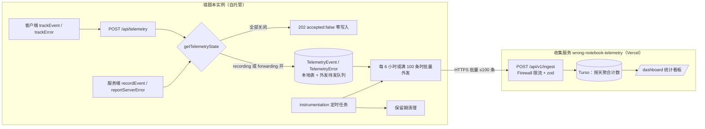
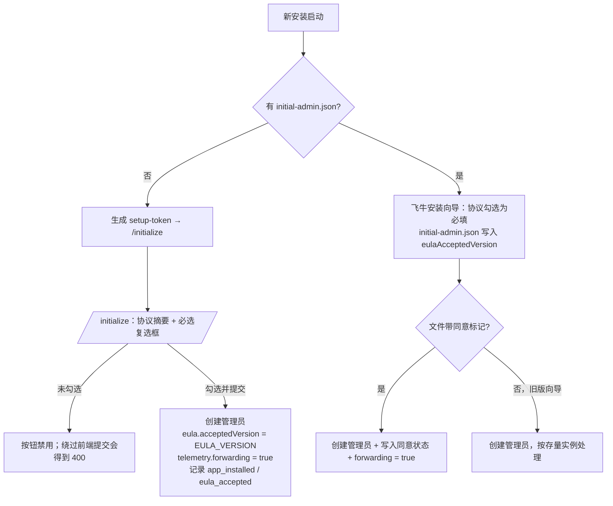

# 设计方案：使用协议 · 匿名使用数据（埋点）· 错误回报 · 收集服务

状态：定稿 v4（全部未决项已确认，可按 §12 实施） · 2026-11-01 · 交付形态：方案文档（本轮不写代码）

已确认决策：
- 数据去向 = **本地留存 + 外发并存**；外发目标是自建在 Vercel 上的收集服务（§7）。
- 使用协议**只针对管理员**：新安装由创建管理员的人同意；**协议升级时管理员必须重新同意**。普通用户不看、不签协议，也不受影响。
- 本地记录**默认关闭**；外发只对已同意协议的实例默认开启。
- 开关只在实例级，由管理员决定；**普通用户不能单独退出**。
- 收集服务地址 `https://wrong-notebook-telemetry.margrop.net`（自有域名，CNAME 指向 Vercel）；使用 Vercel **免费套餐（Hobby）** + Turso 免费额度；收集服务**源码公开、数据私有**。

关联文档：`doc/PRIVACY.md`、`doc/PRIVACY.en.md`、`doc/LOGGING_GUIDE.md`、`doc/INSTALL_PACKAGES.md`、`doc/wiki/Settings-and-Users.md`

---

## 0. 总览

总原则：**实例级开关、未经管理员同意不外发、外发内容最小化、透明可查**。



各开关在不同实例上的默认值：

| 开关 | 新安装（管理员同意了协议） | 存量升级 / 旧版预置安装 | 协议升级后尚未重新同意 | 关闭方式 |
|---|---|---|---|---|
| 本地记录 `recording` | 关 | 关 | 不变 | 设置开关 |
| 错误回报 `errors` | 开（只在 recording 或 forwarding 开启时生效） | 开 | 不变 | 设置开关 |
| 外发 `forwarding` | **开** | **关**（横幅提示管理员可开启） | **暂停**，直到重新同意 | 设置开关 / 环境变量 |
| 环境变量 `TELEMETRY_DISABLED=true` | 优先级最高，强制全部关闭（演示站、内网合规场景） | | | |

- 门面分成三个文件：客户端 `src/lib/telemetry-client.ts`、服务端 `src/lib/telemetry-server.ts`（`import "server-only"`）、两端共用的 `src/lib/telemetry-schema.ts`。
- 遥测数据**不带用户标识或实例标识**（没有 userId / IP / 邮箱 / cookie / 设备指纹 / 实例 ID），只带应用版本和部署形态。

---

## 1. 现状事实（调研结论）

### 1.1 配置与设置
- 应用级配置在 `config/app-config.json`：`src/lib/config/` 中的 `AppConfig`（`types.ts`）、`DEFAULT_CONFIG`（`defaults.ts`）、`getAppConfig` 与 `updateAppConfig`（`store.ts`）。写入用临时文件加 rename；嵌套对象要深合并，可参照 `mergeTtsConfig`。
- 管理员接口的惯例：`getServerSession` + `requireAdmin(session)`，不通过时返回 `forbidden()`（例：`src/app/api/settings/route.ts` 的 POST）。
- 管理员设置分区的先例：`src/components/settings/debug-log-settings.tsx`，在 `settings-dialog.tsx` L191 注册。
- 版本号取自 `src/lib/app-version.ts`，优先使用构建时注入的 `APP_VERSION`。

### 1.2 页面登录保护（`src/proxy.ts`）
- matcher 排除了 `api/**`，所以 `/api/telemetry` 不经过 proxy，不需要改。
- 页面里只有 `isAuthPage`（`/login`、`/register`、`/initialize`）允许未登录访问，而且**已登录用户访问这些页面会被重定向到 `/`**。所以 `/eula` 要放进单独的公开页列表。
- 现有的“实例级强制门”先例：`mustChangePassword` 会把管理员重定向到 `/setup`（判断依据在 JWT 里）。
- `AppShell` 在未登录时不渲染导航（L50）。`BARE_PATHS`（L17）实际是 `/login`、`/register`、`/setup`、`/print-preview`、`/exams/*/print`。

### 1.3 首次运行有两条创建管理员的路径
- **初始化链接**：`src/lib/initialization.ts` 生成 setup-token，桌面版和安卓版会自动打开 `/initialize?token=…`，提交到 `src/app/api/initialize/route.ts`（zod 校验、`registerIpLimiter` 限流、一次性领取令牌）。
- **预置管理员**：飞牛OS 安装向导通过 `packaging/fnos/cmd/install_callback` 和 `initial-admin.mjs` 写入 `config/initial-admin.json`，启动时由 `initialization.ts`（L21-42）直接创建管理员，**不经过 `/api/initialize`**。

### 1.4 错误处理现状
- 服务端：65 处 catch 的写法是 `logger.error` 加 `return internalError("Failed to …")`，`internalError` 不接收 error 对象，日志也不写库。
- 客户端：`frontendLogger` 是通用业务日志，context 里常常带 `{ error }`。`installGlobalErrorLogging()` 也走 `frontendLogger.error('[GlobalError]', …)`。项目里**没有 `error.tsx` / `global-error.tsx`**。
- 限流：`src/lib/rate-limit.ts` 在进程内计数；`getClientIp` 拿不到 IP 时返回 null（本机直连、安卓单机版都会这样）。
- 整个仓库没有任何埋点或向外上报的代码。

### 1.5 部署形态
- 主要部署形态（Docker、npm、桌面版、飞牛OS、安卓）都是**常驻 Node 进程**，可以跑定时任务和外发队列。
- Vercel 演示站（`demo/vercel` 分支：serverless、Turso，`config/` 只读）设置 `TELEMETRY_DISABLED=true`。
- 演示站已经用 `@prisma/adapter-libsql` 加 `@libsql/client` 连接 Turso，收集服务沿用同一套技术栈（§7）。

---

## 2. 实例端数据模型

### 2.1 app-config.json 新增字段（不需要迁移）

```jsonc
{
  "eula": {
    "acceptedVersion": "v1",                       // 管理员最近一次同意的协议版本
    "acceptedAt": "2026-11-01T00:00:00.000Z",
    "acceptedBy": "initialize"                     // initialize | preset | admin-dialog；不记录是哪个用户
  },
  "telemetry": {
    "recording": false,        // 本地记录，默认 false
    "errors": true,            // 错误回报，默认 true
    "forwarding": false,       // 外发；同意协议时写入 true，缺省 false
    "endpoint": "",            // 留空 = 使用内置的官方地址 DEFAULT_TELEMETRY_ENDPOINT；可改成自建收集服务的地址
    "retentionDays": 30,       // 本地记录的保留天数，1–365
    "noticeDismissedAt": null, // 存量实例的告知横幅被关闭的时间
    "lastFlushAt": null        // 上次外发成功的时间（§3.5，系统维护，不在设置界面显示）
  }
}
```

- `config.ts`：给 `AppConfig` 加字段，并新增 `mergeTelemetryConfig`、`mergeEulaConfig` 用于深合并；`retentionDays` 读取时限制在 1–365。
- 统一读取入口 `getTelemetryState()`，返回 `{ recording, errors, forwarding, endpoint, retentionDays, lockedByEnv, consentPending }`，计算规则：
  - `TELEMETRY_DISABLED=true` 时全部为 false，`lockedByEnv=true`。
  - `consentPending = eula.acceptedVersion` 存在且不等于 `EULA_VERSION`。此时 `forwarding` 实际按 false 处理（配置值不变，管理员重新同意后自动恢复）。
  - `endpoint` 为空时使用 `DEFAULT_TELEMETRY_ENDPOINT`（`src/lib/telemetry-server.ts` 中的常量）。
- `.env.example` 新增 `TELEMETRY_DISABLED`。

### 2.2 Prisma 新增两张表（一次迁移，只做加法）

这两张表**同时充当本地记录和外发待发队列**：

```prisma
model TelemetryEvent {
  id          String    @id @default(cuid())
  name        String              // 事件名（§4 白名单）
  payload     String?             // JSON；只有布尔、分桶值、白名单枚举
  version     String
  createdAt   DateTime  @default(now())
  forwardedAt DateTime?           // 外发成功的时间；null 表示待发
  local       Boolean             // 写入时 recording 是否开启；false 的记录外发成功后就删除

  @@index([createdAt])
  @@index([forwardedAt, createdAt])
  @@index([name, createdAt])
}

model TelemetryError {
  id          String    @id @default(cuid())
  kind        String              // client | boundary | server
  scope       String              // 白名单前缀，≤64 字符
  name        String              // Error.name，≤64 字符
  fingerprint String              // 16 位十六进制
  message     String?             // 脱敏并截断到 500 字符；只在 local=true 时保存，永不外发
  stack       String?             // 截断到 8000 字符；只在 local=true 时保存，永不外发
  path        String?             // 归一化后的 pathname；只在 local=true 时保存
  userAgent   String?             // 只存大类，如 "Chrome 140 / Android"；只在 local=true 时保存
  version     String
  createdAt   DateTime  @default(now())
  forwardedAt DateTime?
  local       Boolean

  @@index([createdAt])
  @@index([forwardedAt, createdAt])
  @@index([fingerprint, createdAt])
}
```

写入规则：
- recording 和 forwarding 都关闭时，什么都不写。
- 只开 recording：写入完整记录，`local=true`，不外发。
- 只开 forwarding：只写外发需要的字段（错误不保存 message、stack、path、UA），`local=false`，外发成功后删除。
- 两个都开：写入完整记录，`local=true`，外发后保留到保留期结束。

迁移命令：`npx prisma migrate dev --name add_telemetry_tables`。迁移只新增表，兼容生产环境的 `PRESERVE_EXISTING_DATA=true`。

### 2.3 导入导出
**遥测表和 `eula` / `telemetry` 配置都不进入备份**：它们属于实例数据，不是用户的错题内容。导出、导入接口不改，`version` 维持 3。`data-backup.test.ts` 加一条断言，确认导出文件不含遥测数据。

---

## 3. 实例端埋点实现

### 3.1 共享 schema `src/lib/telemetry-schema.ts`
- 每个事件对应一个 zod `strictObject`，值只允许 `boolean`、`enum` 和分桶枚举，**不允许 `z.string()` 自由文本**。
- provider 枚举从 `AppConfig['aiProvider']` 的取值集合推导，TTS 模式复用 `TTS_MODES`，不手写。
- `normalizePage(pathname)` 把路径映射成页面枚举，未知路径记为 `other`。
- `TELEMETRY_SCHEMA_VERSION = 1`；外发协议里带这个版本号（§7.3）。

### 3.2 客户端门面 `src/lib/telemetry-client.ts`

```ts
export function trackEvent<N extends TelemetryEventName>(name: N, payload?: TelemetryEventPayloads[N]): void;
export function trackError(input: { kind: "client" | "boundary"; scope: string; error: unknown }): void;
```

- 不等待结果、失败静默：优先用 `navigator.sendBeacon`，不行再退回 `fetch` + `keepalive`，任何异常都吞掉；`trackError` 加防重入。
- 客户端不预取开关状态，服务端关闭时返回 202 `{accepted:false}`。只用 sessionStorage 做两种去重：`app_opened` 每个会话一次、同一错误指纹每个会话一次。不用 cookie，也没有 sessionId。

### 3.3 上报端点 `POST /api/telemetry`（不需要登录）
1. 请求体超过 16KB 返回 413。
2. 限流：`telemetryIpLimiter = new RateLimiter({ limit: 60, windowMs: 60_000 })`，每个请求都 `hit`；`getClientIp` 返回 null 时用共享 key `"unknown"`。
3. 用 `getTelemetryState()` 判断写入规则（§2.2）：都不写时返回 202；kind 为 error 且 `errors=false` 时返回 202。
4. 按 `kind` 分别用 zod 校验：event 走严格白名单；error 接收 `{ kind, scope, name, message ≤2000, stack ≤8000, path, userAgent }`，再经过脱敏和归一化（§5.4）。
5. 写库后返回 200 `{accepted:true}`；校验失败 400，被限流 429。
6. 这个路由自身出错时**不调用** `reportServerError`，防止递归。

### 3.4 服务端门面 `src/lib/telemetry-server.ts`

```ts
export async function recordEvent(name, payload?): Promise<void>;           // 绝不抛错
export async function reportServerError(scope: string, error: unknown): Promise<void>;
export async function flushOutbox(): Promise<{ sent: number }>;             // §3.5
export async function purgeTelemetry(): Promise<number>;                    // §3.6
export const DEFAULT_TELEMETRY_ENDPOINT = "https://wrong-notebook-telemetry.margrop.net/api/v1/ingest"; // §7.1
```

### 3.5 外发队列（取代 v2 的“每条事件立即转发”）
- 由 `src/instrumentation.ts` 在 Node 运行时启动（`setInterval(...).unref()`，每 10 分钟检查一次），只有 forwarding 实际生效时才执行。满足以下任一条件才真正发送，以控制免费套餐的调用量（§7.8）：
  - 距上次成功发送已满 **6 小时**（启动时距上次发送已超过 6 小时的，在启动 1 分钟后发送）；
  - 待发记录已满 **100 条**。
  上次发送时间保存在 `telemetry.lastFlushAt`（app-config，进程重启后仍然有效）。
- 每批最多取 100 条 `forwardedAt IS NULL` 且创建时间在 7 天内的记录（事件和错误混在一起），按 §7.3 的格式 POST 到 endpoint，8s 超时。
- 收到 2xx：把这批记录标记为已发；其中 `local=false` 的直接删除。
- 失败：不标记，下一轮重试；超过 7 天还没发出去的，由清理任务删除。
- 遵守服务端的退避指令：响应中的 `retryAfterSec` 会推迟下一轮，`minIntervalSec` 会把 6 小时的发送间隔调大（只能调大，不能调小；用量逼近免费额度时由收集服务统一降频）；收到 410 时，本进程停止外发直到重启（收集服务可以借此远程叫停某个旧版本）。
- 每天第一次 flush 时，先写入一条服务端事件 `instance_alive`（§4），用来统计活跃实例数，不需要实例 ID。

### 3.6 清理
`purgeTelemetry()` 在启动时、之后每 6 小时执行，打开管理员面板时也会执行一次：
- `local=true` 且超过 `retentionDays` 的记录：删除。
- `local=false` 且超过 7 天仍未发出的记录：删除。
- 清理与开关状态无关，关掉开关后旧数据照样按期删除。管理员面板另有“立即清空”按钮。

### 3.7 服务端事件
- `/api/initialize` 成功后：`app_installed {method:'setup-token'}` 和 `eula_accepted {version}`。
- 预置管理员创建成功后：`app_installed {method:'preset-admin'}`；初始文件里带同意标记时，再加 `eula_accepted`。
- 管理员在协议升级对话框中同意后：`eula_accepted {version, trigger:'upgrade'}`。

---

## 4. 埋点清单 v1（只有枚举维度，没有自由文本）

**严禁**采集 userId、IP、邮箱、题目内容、OCR 文本、AI 回答和任何自由文本。

| 事件名 | 端 | 触发时机 | payload |
|---|---|---|---|
| `app_installed` | server | 管理员创建成功 | method: `setup-token` \| `preset-admin` |
| `eula_accepted` | server | 同意协议 | version, trigger: `install` \| `upgrade` |
| `instance_alive` | server | 每天第一次 flush 时 | platform: `docker` \| `npm` \| `desktop` \| `fnos` \| `android` \| `other`；aiConfigured: bool |
| `app_opened` | client | 每个浏览器会话一次 | client: `browser` \| `pwa` \| `desktop` \| `android` |
| `page_viewed` | client | pathname 变化，且页面枚举与上一次不同 | page: home \| notebooks \| error_detail \| practice \| review \| stats \| tags \| exams \| settings \| admin \| other |
| `ai_analyze_started` | client | 提交题目分析 | provider |
| `ai_analyze_result` | client | 分析成功或失败 | ok, provider, duration: `<3s` \| `3-10s` \| `10-30s` \| `>30s` |
| `ai_reanswer` | client | 重新解答成功或失败 | ok, provider |
| `ai_practice_grading` | client | 练习批改成功或失败 | ok, count: `1` \| `2-5` \| `6-20` \| `>20` |
| `exam_paper_generation` | client | 组卷成功或失败 | ok, count（同上分桶） |
| `data_exported` | client | 导出成功 | scope: `user` \| `all`, rows: `0` \| `1-50` \| `51-500` \| `>500` |
| `data_imported` | client | 导入成功 | rows（同上分桶） |
| `tts_used` | client | 使用朗读（每个会话每种 mode 只记一次） | mode: `TTS_MODES` |
| `settings_changed` | client | 设置保存成功 | section: 设置分区 key |

- `platform` 由打包时注入的 `WN_PLATFORM` 环境变量决定（各安装包的启动器设置，缺省为 `other`），同步更新 `.env.example` 和 `doc/INSTALL_PACKAGES.md`。
- 错误率从错误表聚合得到，不再设单独的错误事件。不做采样。

---

## 5. 错误回报

### 5.1 捕获点

| 层 | 改动 |
|---|---|
| 全局 JS 错误 / 未处理的 Promise 拒绝 | 在 `installGlobalErrorLogging` 的监听器里**额外**调用 `trackError({kind:'client', scope:'[GlobalError]'})`；`frontendLogger.error` 本身不改 |
| 渲染错误 | 新增 `src/app/error.tsx`（在 `useEffect` 中上报，并提供“重试”按钮调用 `reset()`）和 `src/app/global-error.tsx`（自带 `<html><body>`，中英文案静态内联） |
| API 5xx | 给 `internalError` 加可选参数 `options?: { error?: unknown; scope?: string }`；传入 error 时通过**动态 import** 调用 `reportServerError`。v1 先接入 `/api/ai/*`、分析、`/api/initialize`、导入导出、练习批改、组卷这些路由，其余逐步补齐 |
| 4xx | 不上报 |

不在 `logger.error` 层做全量旁路，避免写入放大和隐私风险。

### 5.2 去重
- 客户端：同一指纹每个会话只报一次。
- 服务端：同一指纹 1 分钟内只写一行（内存 LRU，最多 500 个 key）。

### 5.3 指纹
`fingerprint = sha256(kind + scope + name + 归一化后的堆栈首帧)` 取前 16 位。归一化时去掉行列号以外的 URL 部分，以及构建产物的 chunk 哈希，让同一个 bug 在不同实例、不同构建下得到相同的指纹。

### 5.4 脱敏（服务端在写库前执行）
- `path`：只保留 pathname，把 cuid、十六进制、长数字片段替换成 `:id`。
- `message`：邮箱替换为 `<email>`，6 位以上的数字替换为 `<num>`，URL 去掉查询串，最后截断到 500 字符。
- `stack`：只保留 `at …` 帧，帧里只留 pathname，截断到 8000 字符。
- `userAgent`：只保留浏览器大类、主版本和系统大类。
- 即使脱敏，message 和 stack 仍可能残留业务文本，所以它们**只在 recording 开启时保存在本地，永不外发**。

---

## 6. 使用协议（只针对管理员）

### 6.1 范围与文本
- **签署人只有管理员**。协议约束的是部署和运营实例的一方，内容涵盖软件许可和实例级数据收集。普通用户的注册、登录和使用流程**完全不变**：不显示协议、不弹窗、不加说明。
- 新增 `doc/EULA.md` 和 `doc/EULA.en.md`：通用模板，包括许可授予（与仓库 LICENSE 冲突时以 LICENSE 为准）、知识产权、**数据收集**（遥测分三层开关、外发只有统计和错误指纹、收集服务托管在 Vercel、收集服务不保存 IP）、管理员告知本实例用户的责任、免责声明、责任限制、终止条款、准据法，并注明“通用模板，非法律意见”。
- `src/lib/eula.ts`：
  ```ts
  export const EULA_VERSION = "v1";
  /** 每个版本相对上一版的变更摘要，升级对话框会展示 */
  export const EULA_CHANGES: Record<string, { zh: string[]; en: string[] }> = { v1: { zh: [], en: [] } };
  ```
- **何时升级版本号**：协议的实质内容有变化（权利义务、数据收集范围、外发对象）时升版本；纯排版、错别字修改不升。升版本必须同时补上 `EULA_CHANGES`，由单元测试检查每个版本都有摘要。

### 6.2 新安装时的同意



- `/initialize` 页面：新增 `src/components/initialize/eula-consent.tsx`，内容是协议摘要 3–5 条、“查看完整协议”（新标签页打开 `/eula`），以及**必选复选框**。文案：“我作为本实例的管理员，已阅读并同意《使用协议》，并知悉实例会向错题本收集服务发送匿名的功能统计与错误指纹（可在设置中关闭）”。
- 服务端：`initializeSchema` 增加 `eulaAccepted: z.literal(true)`。管理员创建成功后，在同一个请求内写入同意状态；写配置失败只记日志、不回滚，此时实例停留在“未同意”状态，外发保持关闭，这是安全的一侧。
- 飞牛OS：向导配置加一个必选 checkbox，`install_callback` 把 `WN_EULA_ACCEPTED=<版本>` 传给 `initial-admin.mjs`，`initial-admin.ts` 解析这个可选字段。旧版文件没有这个字段，向后兼容。用测试机执行 `install-fpk -e` 验证。

### 6.3 存量实例（从来没签过协议）
- 不拦截。管理员登录后，AppShell 顶部显示一次可关闭的横幅：“新版本支持向错题本收集服务发送匿名统计与错误指纹，帮助改进产品，目前处于关闭状态。[查看并开启] [不再提示]”。
- 管理员在设置里开启外发时，会弹出协议对话框，**勾选同意后才能打开开关**。同意后写入 `eula.acceptedVersion`，`acceptedBy` 记为 `admin-dialog`。从这时起，该实例按“已签协议”的规则处理，以后协议升级也要重新同意。
- 只开本地记录不需要签协议，因为数据不离开本机。

### 6.4 协议升级时重新同意
条件：`eula.acceptedVersion` 存在且不等于 `EULA_VERSION`（`consentPending`）。

- **强制门（只拦管理员）**：
  - `GET /api/eula/status`（需要登录）返回 `{ pending, current, accepted, changes }`；普通用户请求时始终返回 `pending:false`。
  - AppShell 中新增 hook `src/lib/hooks/use-eula-gate.ts`：当前用户是管理员且 `pending` 时，显示**无法关闭的全屏对话框**，内容包括本次变更摘要（`EULA_CHANGES`）、完整协议链接、“同意并继续”和“退出登录”两个按钮。管理员不同意就无法进入任何页面，这和 `mustChangePassword` 的门禁力度相同。
  - 门禁放在客户端，不放在 proxy：proxy 只信 JWT，同意状态在 app-config 中，而且需要实时读取。真正的约束在服务端：`consentPending` 时外发暂停（§2.1），所有 `/api/admin/*` 写操作返回 409 `EULA_PENDING`，只有同意接口和 `GET` 类接口除外。
  - `POST /api/admin/eula/accept`（requireAdmin + `{version}` 必须等于当前版本）：写入同意状态，记录 `eula_accepted {trigger:'upgrade'}`，外发自动恢复。
- **普通用户不受影响**：可以继续正常使用；协议升级期间实例只是暂停外发。
- **多个管理员**：任意一位管理员同意后即对整个实例生效（同意是实例级的，不记录是哪个管理员）。
- **兼容**：从没签过协议的存量实例（`acceptedVersion` 不存在）不会进入强制门，继续按 §6.3 处理。

### 6.5 公开查看页
- `src/app/eula/page.tsx`：服务端组件，按语言渲染 `EULA.md` 或 `EULA.en.md`。协议文本通过静态 import 打进构建产物（放在 `src/lib/eula/` 下，保证 standalone 构建和所有安装包都带上），`doc/EULA*.md` 作为文档副本，由单元测试检查两份内容一致。
- `src/proxy.ts`：新增 `PUBLIC_PATHS = ["/eula"]`，在 `isAuthPage` 判断之前直接放行（登录与否都放行），catch 分支同样放行。这个页面要公开，是因为 `/initialize` 页面需要在未登录时打开它。
- 入口只出现在管理员能看到的地方：`/initialize` 协议区、升级对话框、设置中的“隐私与遥测”分区。**登录页和普通用户的“关于”页不加入口**。

---

## 7. 收集服务（Vercel）

### 7.1 形态与技术选型
- **独立项目** `../wrong-notebook-telemetry`，GitHub 公开仓库 `margrop/wrong-notebook-telemetry`，**源码公开、数据私有**：任何人都能核查服务端收了什么、存了什么，这本身就是隐私承诺的一部分；也可以用同一份代码自建收集服务，把实例的 `endpoint` 指过去。
  - 数据私有的边界：数据库连接串、看板密码等密钥只放在 Vercel 环境变量中，仓库只提交 `.env.example`；仓库中不含任何真实统计数据、导出文件或截图；看板必须登录；README 写明“源码公开，数据仅维护者可见”。
  - 公开仓库同样遵守提交前检查：`.gitignore` 排除 `.env*`、`.vercel/`、本地 libSQL 文件，CI 中加一步密钥扫描（如 gitleaks）。
  - 许可证与主仓库一致。
- 技术栈：Next.js 16 App Router 部署在 Vercel，使用默认的 Node.js 运行时（Fluid Compute），不用 Edge。
- 存储：**Turso**（libSQL），通过 Prisma 加 `@prisma/adapter-libsql` 访问，与演示站的技术栈一致，可以复用经验。实施时先用 `vercel integration discover --category storage` 确认 Turso 的 Marketplace 集成，再执行 `vercel integration add`，环境变量自动注入（`TURSO_DATABASE_URL` / `TURSO_AUTH_TOKEN`），本地开发用 `vercel env pull`。
- 域名：**`wrong-notebook-telemetry.margrop.net`**，服务仍部署在 Vercel，通过 CNAME 绑定：
  - 在 Vercel 项目的 Domains 中添加该域名（或执行 `vercel domains add wrong-notebook-telemetry.margrop.net`），按 Vercel 显示的值在 Cloudflare（margrop.net 的 DNS 托管方）添加 `CNAME wrong-notebook-telemetry → <Vercel 给出的目标>`，**代理状态设为“仅 DNS”（灰云）**，由 Vercel 自动签发和续期 HTTPS 证书。
  - 不用 Cloudflare 橙云代理：开启后会挡住 Vercel 的证书签发与续期，也会让 Vercel Firewall 看到的来源 IP 变成 Cloudflare 节点，按 IP 限流就会失效。
  - 写进代码和协议的只有自有域名，项目自带的 `*.vercel.app` 地址只作调试用。以后即使迁出 Vercel，只要改 DNS 就行，已发布的实例不受影响。
  - 中国大陆的 `*.vercel.app` 存在 DNS 污染，自有域名可以避开这个问题，对国内自托管实例的外发成功率有帮助（但 Vercel 节点在国内的访问速度仍然一般，外发失败时队列会重试，不影响业务）。

### 7.2 接口

| 路径 | 方法 | 说明 |
|---|---|---|
| `/api/v1/ingest` | POST | 实例批量上报，不鉴权 |
| `/api/v1/health` | GET | 健康检查 |
| `/api/cron/maintain` | GET | Vercel Cron 每天调用，校验 `CRON_SECRET` |
| `/dashboard/**` | 页面 | 统计看板，需要登录（§7.6） |
| `/privacy` | 页面 | 收集服务的隐私说明（存什么、不存什么、保留多久） |

### 7.3 上报协议 v1

```jsonc
POST /api/v1/ingest
Content-Type: application/json
User-Agent: wrong-notebook/<version>
{
  "schema": 1,
  "app": "wrong-notebook",
  "version": "2026.11.1",
  "items": [                                   // 1–100 条
    { "t": "event", "day": "2026-11-01", "name": "ai_analyze_result",
      "payload": { "ok": true, "provider": "openai", "duration": "3-10s" } },
    { "t": "error", "day": "2026-11-01", "kind": "server", "scope": "api:ai",
      "name": "TypeError", "fingerprint": "a1b2c3d4e5f60718" }
  ]
}
```

响应：
- `200 { accepted: n, rejected: m, retryAfterSec?: number, minIntervalSec?: number }`（`minIntervalSec` 用于统一降频，见 §3.5、§7.8）：部分条目不合法时只丢弃这些条目，整批仍按成功处理，避免实例反复重发。
- `400`：整体结构不合法。`413`：请求体超过 64KB。`429`：被限流（带 `Retry-After`）。
- `410`：该 `schema` 或 `version` 已被停用，实例本进程停止外发。

**宽松校验，与实例的发版节奏解耦**：收集服务不维护事件白名单，只校验数据形状，让新版本加了事件也不必先改收集服务：
- `name`：`^[a-z][a-z0-9_]{1,47}$`；payload 最多 8 个键，键名格式同上；值只能是 boolean，或匹配 `^[A-Za-z0-9_.<>+-]{1,32}$` 的短 token。**结构上就放不下自由文本。**
- `day`：只接受 `[今天-7, 今天+1]`（UTC）范围内的日期，超出的拒收。
- error 条目：`kind` 必须是枚举值，`scope` ≤ 64 字符且只允许 token 字符，`fingerprint` 必须是 `^[0-9a-f]{16}$`。
- 带 `Origin` 头的请求返回 403。浏览器不会直接访问收集服务，只有实例服务端会；因此也不设置 CORS。

### 7.4 数据模型：只存按天聚合的计数，不存原始事件

```prisma
/// 事件按天聚合：同一天、同版本、同事件名、同 payload 的事件累加成一行
model DailyEvent {
  day        String   // YYYY-MM-DD（UTC）
  version    String
  name       String
  payloadKey String   // 规范化 JSON（键排序）；空 payload 记为 "{}"
  count      Int      @default(0)
  @@id([day, version, name, payloadKey])
  @@index([name, day])
}

/// 错误指纹登记
model ErrorFingerprint {
  fingerprint  String   @id
  kind         String
  scope        String
  name         String
  firstSeenDay String
  firstVersion String
  lastSeenDay  String
  lastVersion  String
  total        Int      @default(0)
  status       String   @default("open")   // open | ignored | fixed（看板中手动标记）
  note         String?                      // 维护者备注，例如关联的 issue 链接
}

/// 错误按天聚合
model DailyError {
  day         String
  version     String
  fingerprint String
  count       Int      @default(0)
  @@id([day, version, fingerprint])
  @@index([fingerprint, day])
}

/// 服务端运行参数（cron 和看板写入，ingest 读取后在函数实例内缓存 5 分钟）
model ServiceSetting {
  key       String   @id   // minIntervalSec | pausedUntil | disabledVersions
  value     String
  updatedAt DateTime @updatedAt
}

/// 用量记录（cron 每天写入，用于免费额度预警）
model DailyUsage {
  day      String  @id
  batches  Int     @default(0)   // ingest 时累加
  items    Int     @default(0)
  rejected Int     @default(0)
}
```

- `ServiceSetting` 可以在看板中修改，修改后最多 5 分钟生效，不需要重新部署；环境变量 `INGEST_PAUSED` / `INGEST_DISABLED_VERSIONS` 作为应急备用，优先级更高。

- 写入：一个批次先在内存中按主键分组，然后在一个事务里批量 upsert（`count = count + n`）。**不保存单条事件、精确时间戳或请求来源**，从存储上就无法关联到具体实例。
- 活跃实例数：每个实例每天只发一条 `instance_alive`，所以当天 `instance_alive` 的计数约等于日活实例数，按 platform 可以拆分。这是近似值，因为实例当天离线或重试可能导致少计或多计，看板上要注明。
- 安装数：`app_installed` 的计数。

### 7.5 安全与滥用防护
- **限流分两层**（免费套餐下 Firewall 自定义规则和限流规则的额度有限，实施时按当时的官方文档核对）：
  - 平台层：如果 Hobby 可用，配置一条 Firewall 限流规则，`/api/v1/ingest` 每 IP 每分钟 10 次，超出返回 429。正常实例每 6 小时才发一批，远低于这个阈值。规则写进仓库的部署文档，用 `vercel firewall` CLI 管理。
  - 应用层（不论平台规则是否可用都实施）：函数实例内存里按 IP 计数（每分钟 10 次，只用于计数，不落库、不打日志）。Fluid Compute 会复用实例，所以这层限流是尽力而为；由于数据只做聚合计数，被绕过的最坏后果只是统计失真。
  - Vercel 平台自带的 DDoS 防护在免费套餐下同样生效。
- 应用层：请求体 ≤ 64KB，每批 ≤ 100 条，zod 校验，单条 payload 最多 8 个键。
- **数据可能被伪造**：上报不鉴权，因为开源客户端里放不了密钥，所以任何人都能刷假数据。缓解手段：限流、`day` 窗口、看板标出异常尖峰。统计数据只作为趋势参考，在看板和文档中如实说明。
- **IP**：应用代码不读取、不写入 IP，也不在日志中打印请求头。Vercel 平台的访问日志会按平台策略短期保留 IP，这一点在 `/privacy`、`PRIVACY.md` 和 EULA 中如实写明。
- 远程停用开关：环境变量 `INGEST_DISABLED_VERSIONS`（逗号分隔），命中时返回 410；`INGEST_PAUSED=true` 时所有请求返回 `200 {accepted:0, retryAfterSec:3600}`，让实例自动退避。

### 7.6 看板
- 页面：总览（日活实例、安装数、各版本占比、各部署形态占比）、功能使用（按事件、按维度）、AI（各 provider 的成功率和耗时分布）、错误（按指纹排序，可看趋势、首次出现的版本、最近出现的版本，可以标记状态和备注）。
- 鉴权：环境变量 `DASHBOARD_PASSWORD_HASH`（bcrypt），登录后签发 HttpOnly + Secure + SameSite=Strict 的签名 cookie（`DASHBOARD_SESSION_SECRET`），有效期 7 天；登录接口在应用层限流（每 IP 每 15 分钟 5 次失败）。只有维护者一个人使用，暂不接入完整的身份认证系统，以后需要多人访问时再迁到 Sign in with Vercel。
- 图表：服务端组件直接查询聚合表，前端只负责渲染；按天的查询加 Runtime Cache 缓存 5 分钟。

### 7.7 保留与维护（Vercel Cron）
- `vercel.ts` 中配置 `crons: [{ path: '/api/cron/maintain', schedule: '17 3 * * *' }]`。免费套餐的 Cron 每天最多执行一次，并且实际执行时间会在指定的那个小时内浮动，维护任务对时间不敏感，可以接受。
- `DailyEvent` / `DailyError` 保留 **400 天**（足够做年度同比）；`ErrorFingerprint` 中 `lastSeenDay` 超过 400 天的记录一并删除。
- 维护任务另外检查 Turso 用量，写入当天的统计（行数），看板上会显示。

### 7.8 部署与成本
- Vercel 项目 `wrong-notebook-telemetry`，生产分支为 `main`，预览部署连接**单独的 Turso 预览库**（Marketplace 集成为 Preview 环境单独配置变量），预览环境不会写入生产数据。
- 环境变量：`TURSO_*`（集成自动注入）、`CRON_SECRET`、`DASHBOARD_PASSWORD_HASH`、`DASHBOARD_SESSION_SECRET`、`INGEST_DISABLED_VERSIONS`、`INGEST_PAUSED`。
- **套餐：Vercel Hobby（免费）+ Turso 免费额度**。前提是项目非商用：开源、免费、不收费也不放广告。项目性质如果变化，需要重新评估套餐。
- **免费额度预算**（具体额度以实施时的官方文档为准，下面按数量级估算）：
  - 函数调用：每个实例每天约 4 次（每 6 小时一批），1,000 个活跃实例约 12 万次/月；加上看板和 cron，可以忽略不计。实例数涨到约 5,000 时，接近百万级的月调用额度，由收集服务通过 `minIntervalSec` 统一把发送间隔调到 12–24 小时（§3.5），不需要改客户端。
  - 函数执行时间：一次 ingest 只做校验加一次事务 upsert，目标耗时 < 200ms，`maxDuration` 设为 10s。
  - Turso：写入量是“批次数 × 每批去重后的分组数”，一个实例一天通常只有几十个分组；存储量随“天 × 版本 × 事件 × 维度组合”增长，与实例数无关，400 天的保留期内估计在十万行量级。
  - 数据传输：每批 ≤ 64KB，可以忽略。
- **额度保护**：
  - `/api/cron/maintain` 每天汇总前一天的调用次数和行数；超过额度的 70% 时，在看板上标红，并自动把 `minIntervalSec` 写入 Turso 中的 `ServiceSetting` 表（每次 ingest 时读取，并在函数实例内缓存 5 分钟），全体实例随之降频。
  - 在 Vercel 控制台开启用量通知。Hobby 套餐超额后会暂停服务，不会产生费用；服务暂停期间，实例端的队列会重试 7 天后丢弃，不影响业务。
- **日志**：免费套餐的运行时日志保留时间很短，这反而减少了平台日志中 IP 的留存，在 `/privacy` 中如实写明。
- 测试：Vitest 单元测试（校验规则、payloadKey 规范化、upsert 分组）、集成测试（用本地 libSQL 文件跑 ingest 和 cron）。仓库自带 CI。

### 7.9 实例与收集服务的契约测试
- 实例仓库的 `telemetry-client` / `telemetry-server` 测试中，用 §7.3 的宽松规则（复制一份 `ingest-contract.ts` 及其测试向量）校验 `telemetry-schema.ts` 中的所有事件，确保实例生成的 payload 一定能被收集服务接受。
- 收集服务仓库保存同一组测试向量。规则变更时两边一起改，协议的 `schema` 版本号加 1。

---

## 8. 管理员设置与文案

### 8.1 设置 UI `src/components/settings/telemetry-settings.tsx`（分区名“隐私与遥测”，只有管理员可见）
- 协议状态：当前签署的版本和时间，“查看协议”链接。
- 开关：本地记录 / 错误回报 / 外发（打开外发前，若尚未签协议，弹出协议对话框，见 §6.3）。
- 外发地址：默认显示“官方收集服务”，可以展开改成自建地址（只允许 https，局域网地址可以用 http）。
- 保留天数（1–365）。
- “本实例收集了什么”：`GET /api/admin/telemetry` 返回最近 20 条事件和错误、待发数量、上次外发的时间和结果。
- “立即清空”：`DELETE /api/admin/telemetry`。
- `lockedByEnv` 时所有控件只读，并说明原因。组件超过约 200 行时，拆分到 `src/components/settings/telemetry/`。

### 8.2 文案
在 translations.ts 中新增 `t.settings.telemetry` 和 `t.eula` 两段，中英文 key 一致。主说明：

> 「帮助改进错题本：开启外发后，实例会定期向错题本收集服务发送匿名的功能使用统计和错误指纹，不含个人身份、错题内容、AI 对话或错误原文。本地记录默认关闭，开启后只保存在本机，供管理员排查问题。」

---

## 9. 文件变更清单

### 9.1 本仓库（wrong-notebook）

**新增**
- `doc/EULA.md`、`doc/EULA.en.md`，`src/lib/eula/`（协议正文的静态模块）、`src/lib/eula.ts`
- `src/lib/telemetry-schema.ts`、`telemetry-client.ts`、`telemetry-server.ts`、`telemetry-sanitize.ts`、`ingest-contract.ts`
- `src/app/api/telemetry/route.ts`
- `src/app/api/admin/telemetry/route.ts`（GET / POST / DELETE）
- `src/app/api/eula/status/route.ts`、`src/app/api/admin/eula/accept/route.ts`
- `src/lib/hooks/use-eula-gate.ts`、`src/components/eula/eula-upgrade-dialog.tsx`、`src/components/eula/eula-consent-dialog.tsx`
- `src/components/settings/telemetry-settings.tsx`、`src/components/telemetry-notice-banner.tsx`
- `src/components/initialize/eula-consent.tsx`
- `src/app/error.tsx`、`src/app/global-error.tsx`、`src/app/eula/page.tsx`
- `prisma/migrations/<ts>_add_telemetry_tables/`
- 测试：`unit/telemetry-schema`、`telemetry-sanitize`、`telemetry-client`、`ingest-contract`、`eula`；`integration/telemetry-route`、`telemetry-outbox`、`admin-telemetry-route`、`eula-routes`；`e2e/eula-and-telemetry.spec.ts`

**修改**
- `src/lib/config/`、`prisma/schema.prisma`、`src/lib/rate-limit.ts`、`src/lib/api-errors.ts`
- 高价值路由的 catch 块、`src/lib/frontend-logger.ts`（全局监听追加上报）、`src/instrumentation.ts`（外发队列和清理）
- `src/app/api/initialize/route.ts`、`src/components/initialize/initialize-form.tsx`
- `src/lib/initial-admin.ts`、`src/lib/initialization.ts`
- `packaging/fnos/`（向导、`install_callback`、`initial-admin.mjs`）；各安装包启动器注入 `WN_PLATFORM`（docker 写在 Dockerfile 中，npm、desktop、fnos、android 写在各自的启动器中）
- `src/proxy.ts`（`PUBLIC_PATHS`）、`src/components/app-shell.tsx`（`page_viewed`、横幅、协议升级门禁）
- 各埋点调用点、`settings-dialog.tsx`、`translations.ts`、`.env.example`
- `src/__tests__/integration/data-backup.test.ts`
- 文档：`doc/PRIVACY.md` 及英文版、`doc/LOGGING_GUIDE.md`、`doc/INSTALL_PACKAGES.md`、`doc/wiki/Settings-and-Users.md`、`doc/wiki/Deployment.md` 及 `doc/wiki/en/` 中对应的英文页、`README.md`、`README.en.md`
- `demo/vercel` 分支：环境变量 `TELEMETRY_DISABLED=true`

### 9.2 收集服务仓库（wrong-notebook-telemetry，新建）
`app/api/v1/ingest`、`app/api/v1/health`、`app/api/cron/maintain`、`app/dashboard/**`、`app/privacy`、`lib/ingest-contract.ts`（与实例共用的测试向量）、`lib/aggregate.ts`、`lib/dashboard-auth.ts`、`prisma/schema.prisma` 及迁移、`vercel.ts`、`README.md`（含部署步骤和 Firewall 规则）、测试与 CI。

### 9.3 官网
`../wrong-notebook-github-pages`：中英文页面在功能列表中加一行，并加上隐私说明链接；单独提交。

---

## 10. 测试计划

- **unit**
  - schema：事件白名单、拒绝自由文本、provider 和 TTS 枚举与源常量一致、`normalizePage` 的映射。
  - 脱敏：path、message、stack、UA 的处理；指纹在不同构建下保持稳定。
  - `getTelemetryState`：环境变量优先；`consentPending` 时外发暂停；`endpoint` 为空时回落到默认地址。
  - 契约：所有事件的样例 payload 都能通过 `ingest-contract`。
  - eula：每个版本都有 `EULA_CHANGES` 摘要；`doc/EULA*.md` 与静态模块内容一致。
  - api-errors：不传 error 时行为不变。
  - proxy：未登录和已登录都能访问 `/eula`。
  - 客户端：不抛错、不重入、会话内去重。
- **integration**（mkdtemp + migrate deploy + 真实 SQLite）
  - `telemetry-route`：四种开关组合下的写入规则（§2.2），包括只开外发时错误不保存 message；400、413、429；没有 IP 时走 `"unknown"`。
  - `telemetry-outbox`：mock fetch 收到的批次符合 §7.3 且不含 message 或 stack；2xx 后标记已发，`local=false` 的记录被删除；失败时保留；不满 6 小时且不满 100 条时不发、任一条件满足时发送、重启后按 `lastFlushAt` 续算；遵守 `retryAfterSec`，`minIntervalSec` 只能调大不能调小；收到 410 后停止；`consentPending` 时不发；`instance_alive` 每天一条。
  - 清理：按保留期删除，7 天未发出的待发记录被删除。
  - `admin-telemetry-route`：403、GET、POST 校验、DELETE；未签协议时打开 forwarding 被拒绝。
  - `eula-routes`：普通用户永远 `pending:false`；管理员在 pending 时调用 `/api/admin/*` 写接口返回 409；accept 版本不匹配返回 400，匹配时写入并恢复外发。
  - `initialize`：缺少 `eulaAccepted` 返回 400；成功后写入同意状态、`forwarding=true` 和两条安装事件。
  - `initialization`：预置文件带同意标记和不带标记两种情况。
  - `data-backup`：导出文件不含遥测数据。
- **e2e**（`eula-and-telemetry.spec.ts`；遵守 `e2e-network-guard`，测试时 endpoint 指向本地 mock，不访问外网）
  - 初始化时不勾选协议，按钮保持禁用。
  - 存量实例的管理员能看到横幅，开启外发时会弹出协议对话框。
  - 把 `EULA_VERSION` 模拟为新版本：管理员被门禁拦住，同意后恢复正常；同一时间普通用户正常使用，看不到任何协议内容。
  - 未登录可以访问 `/eula`。
- **收集服务**：在该仓库内单独测试（§7.8）；上线前用一个实例 `endpoint` 指向预览部署做端到端冒烟测试。

---

## 11. 风险与边界

| 风险 | 缓解 |
|---|---|
| 匿名端点被刷（实例端） | 每 IP 每分钟 60 次 + 16KB + 严格白名单 + 指纹去重；最坏结果是多写几行，由保留期兜底 |
| 收集服务被刷或被伪造数据 | Firewall 限流 + `day` 窗口 + 结构上无法容纳自由文本；统计只作趋势参考 |
| 错误原文中含有用户内容 | 脱敏 + 原文只在本地记录开启时保存 + 永不外发 |
| 平台日志保留 IP | 应用不读 IP、不打印请求头；如实披露平台日志的情况 |
| 协议升级把管理员拦在门外 | 只拦管理员，普通用户不受影响；同意只需一步；服务端的约束只是暂停外发和管理员写操作，不影响业务数据 |
| 预置安装绕过协议 | 飞牛向导加必选勾选项，旧版文件按存量实例处理 |
| 收集服务宕机 | 实例端有待发队列，重试 7 天后丢弃，不影响业务；健康检查加 Vercel 部署告警 |
| 被绑定在 Vercel 上 | 收集服务开源、可以自建；实例的 endpoint 可配置；以后有了自有域名，绑定到同一项目即可，旧地址继续可用 |
| 免费额度耗尽 | 6 小时批量发送 + 收集服务统一下发降频 + 70% 预警；超额只会暂停服务，不产生费用，实例端照常运行 |
| 公开仓库泄露数据或密钥 | 密钥只放在 Vercel 环境变量中；`.gitignore` 排除本地数据；CI 做密钥扫描；仓库中不放真实统计数据 |
| 演示站等 serverless 环境 | 设置 `TELEMETRY_DISABLED=true` |
| 遥测代码影响业务稳定性 | 门面全部 try/catch，api-errors 动态 import，上报端点和外发队列自身出错不再触发上报 |
| EULA 模板的法律效力 | 注明“非法律意见”，重要部署请自行咨询 |

---

## 12. 里程碑与提交拆分

本仓库（每步单独提交，`<type>: <中文描述>`，不加 AI 署名）：
1. `feat: 新增匿名遥测基础设施`：config、环境变量、schema 与迁移、门面、上报端点、清理及测试。
2. `feat: 新增前后端错误回报`：error.tsx、global-error.tsx、全局监听、`internalError` 接入、脱敏与去重。
3. `feat: 管理员须同意使用协议`：EULA 正文、`/eula` 页面与 proxy 公开页、`/initialize` 协议区、协议升级门禁、accept 接口。
4. `feat: 飞牛OS安装向导增加使用协议确认`：并在测试机上验证。
5. `feat: 遥测外发队列与部署形态标识`：待发队列、`instance_alive`、`WN_PLATFORM`、契约测试。**等收集服务上线后**再填入 `DEFAULT_TELEMETRY_ENDPOINT`。
6. `feat: 管理员遥测设置与存量实例告知`：设置分区、admin 接口、横幅、translations。
7. `feat: 接入功能使用埋点`
8. `docs: 补充遥测与使用协议文档`：官网单独提交。

收集服务仓库：
- A. 项目骨架、ingest 接口、聚合模型与测试，用 Marketplace 接入 Turso（生产库和预览库分开）。
- B. cron 维护任务、Firewall 规则、远程停用开关。
- C. 看板与看板鉴权。
- 0. 创建 Vercel 项目 `wrong-notebook-telemetry`（Hobby），绑定 `wrong-notebook-telemetry.margrop.net`（Cloudflare 添加 CNAME，仅 DNS），确认 HTTPS 证书签发成功，再创建 GitHub 公开仓库。
- D. 预览环境冒烟测试通过后上线生产，开启用量通知；之后实例端完成第 5 步并发版。

---

## 13. 决策记录

| 编号 | 问题 | 决定 |
|---|---|---|
| D1 | 数据去向 | 本地留存与外发并存 |
| D2 | 本地记录默认值 | 默认关闭 |
| D3 | 协议的签署人 | 只有管理员；普通用户不签、不看协议 |
| D4 | 协议升级 | 管理员必须重新同意；同意之前外发暂停，管理员的写操作被拦截 |
| D5 | 普通用户能否单独退出 | 不能，开关只在实例级 |
| D6 | 收集服务地址 | `https://wrong-notebook-telemetry.margrop.net`（Cloudflare 添加 CNAME 指向 Vercel，仅 DNS 不代理） |
| D7 | Vercel 套餐 | Hobby 免费套餐 + Turso 免费额度 |
| D8 | 收集服务开源 | 源码公开（`margrop/wrong-notebook-telemetry`），数据私有 |

实施时需要按当时的官方文档核对的事项（不影响设计）：Hobby 套餐下 Firewall 限流规则是否可用、函数调用和 Turso 的免费额度数值、Cron 的频率限制。
